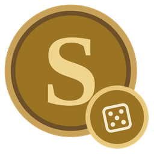

<p align="center"></p>

# Sterling Loot Tracker

A WoW Forever add-on that shows who picked Need, Greed or Pass on every roll, keeps a roll history grouped by dungeon or zone, and remembers where your gear came from.

> **A personal add-on.** I built this for my own needs and share it as is. Support will not be provided, and issues or feature requests may not be answered.

## What it does

**Live roll board**
- Every item up for roll, with who picked Need, Greed or Pass and who hasn't picked yet
- Names in class colors, and a green border as soon as anyone picks Need
- Raids switch to a compact view: a count for each choice, plus the names of everyone who picked Need
- Sits next to the game's roll popups as one stack you can move and lock
- Right-click a roll to dismiss it

**Quieter chat**
- Hides the roll spam (every pick and every roll number) and prints one line when an item is won
- Optional: keep the Need picks and Need rolls in chat

**Roll history**
- Every finished roll is saved, grouped by dungeon or open-world zone
- Click an item to see every pick and roll
- Keeps the last 100 to 1000 items (your choice)

**Gear sources**
- Shows your equipped gear and where each piece came from: quest, boss, dungeon or world drop, trade, auction house, vendor or crafted
- Logged the moment you get an item. Gear you had before installing shows as unknown
- Saved per character. Roll history is shared across your account

## Settings

All of these are in the Settings tab:
- Show the board when solo, in a party, or in a raid
- Minimum item quality for the board
- Hide the board in combat
- How rolls fade out, and how long they stay up
- Board size (80% to 125%) and layout (names, counts, or automatic)
- Sound when someone picks Need
- Minimap button on or off

## Commands

| Command | What it does |
|---|---|
| `/stl` | Open or close the window |
| `/stl test` | Fake rolls for a party of 5 |
| `/stl test raid` | Fake rolls for a 40-player raid |
| `/stl unlock` | Show the handle to move the roll stack |
| `/stl lock` | Hide the handle |
| `/stl reset` | Put the roll stack back in its default spot |

Everything a command does is also a button in the window.

## Install

Add this URL in WowUp: **Get Addons > Install from URL**

```
https://github.com/SterlingAddons/SterlingLoot
```

Or download the zip from [Releases](https://github.com/SterlingAddons/SterlingLoot/releases) and put the `SterlingLoot` folder in `_forever_\Interface\AddOns`. Restart the game after a first install.

## More from Sterling

- [Sterling Quest Sync](https://github.com/SterlingAddons/SterlingQuest) (formerly Sterling Quest Tracker): follow a friend's session and keep quest logs in sync. Works with the optional **Sterling Quest Sync Companion** app.
- [Sterling Hunter](https://github.com/SterlingAddons/SterlingHunter): ammo auto-buy, low ammo warnings and an aspect reminder for hunters.

## License

MIT. See [LICENSE](LICENSE).

Built by Sterling with the help of Claude.
